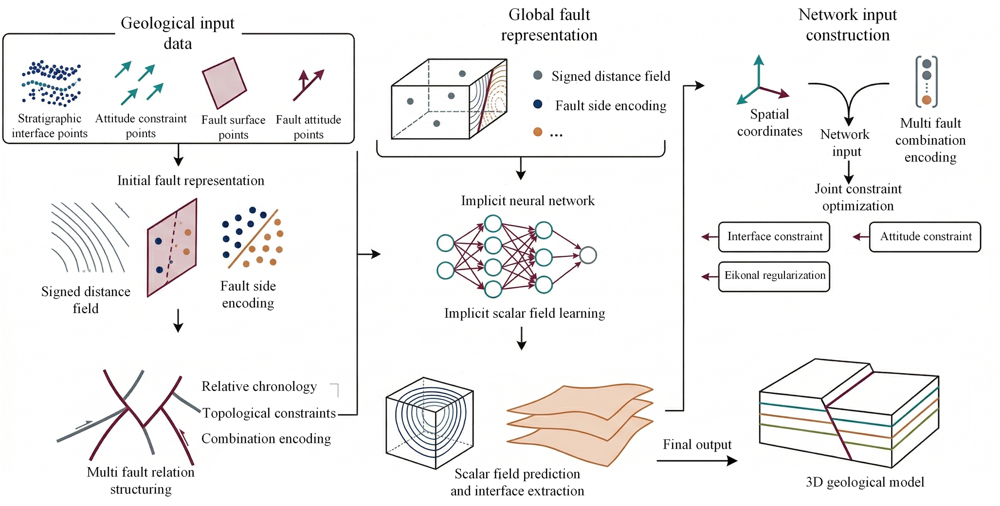

# Fault-Side Encoding and Chronology-Constrained INR

Code and two-fault controlled example for *Implicit Neural Representation for 3D Geological Modeling Using Fault Side Encoding and Chronology Constraints*.

## Required packages

- torch
- numpy
- pandas
- matplotlib
- pyvista
- vtk

Install with:

```bash
python -m pip install -r requirements.txt
```

## Workflow diagram



**Figure.** Geological observations and interpreted fault surfaces are encoded as network inputs. The network predicts a stratigraphic scalar field, from which geological interfaces are extracted and visualized.
